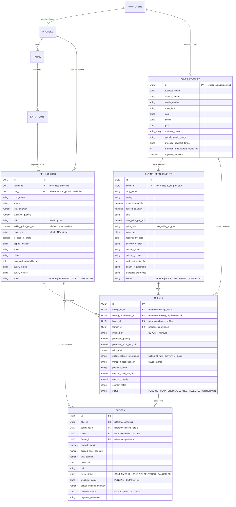

# AgriGuide Market — Buyer Platform Master Plan
**Architecture & Implementation Blueprint for Dedicated Agricultural Buyer Platform**
**Version:** 1.0.0 (Phase 0 Execution Plan)
**Status:** Approved for Architecture Review

---

## 1. Architectural Philosophy & Product Topology

AgriGuide operates as a **Dual-Frontend, Single-Backend Ecosystem**:

```
 ┌────────────────────────────────────────────────────────┐
 │            SHARED SUPABASE POSTGRESQL & AUTH           │
 │                                                        │
 │  • auth.users (Shared Identity UUID)                   │
 │  • profiles / farms / farm_plots (Farmer Ecosystem)    │
 │  • buyer_profiles (Buyer Business Identity)            │
 │  • selling_lots (Explicitly published produce)         │
 │  • buying_requirements (Procurement demands)           │
 │  • offers (Negotiation & counteroffers)                │
 │  • orders (Agreed trade contracts)                     │
 └───────────────────────────┬────────────────────────────┘
                             │
                             │ REST / JSON APIs & Realtime
                             │
             ┌───────────────┴───────────────┐
             │                               │
 ┌───────────▼──────────────┐  ┌─────────────▼──────────────┐
 │   APPLICATION A:         │  │   APPLICATION B:           │
 │   AGRIGUIDE FARMER APP   │  │   AGRIGUIDE MARKET         │
 │                          │  │   BUYER PLATFORM           │
 │   • Farmer decision UI   │  │   • Buyer Dashboard        │
 │   • My Farm / My Crop    │  │   • Live Produce Market    │
 │   • Daily Activities     │  │   • Buying Requirements    │
 │   • Crop Doctor          │  │   • Matching Engine View   │
 │   • Hyperlocal Weather   │  │   • Negotiation & Offers   │
 │   • Port 5173            │  │   • Order Tracking         │
 │   • Pure Green Theme     │  │   • Port 5174              │
 │                          │  │   • Industrial Slate Theme │
 └──────────────────────────┘  └────────────────────────────┘
```

---

## 2. Strict Application Separation Rules

1. **Independent Repositories / Codebases:**
   - Application A (Farmer) remains untouched in `src/`.
   - Application B (Buyer) will reside in its own project directory `buyer-platform/` with its own `package.json`, Vite configuration, and dependency graph.
2. **Zero Farmer UX Contamination:**
   - No buyer tabs, buyer navigation, or buyer widgets inside AgriGuide.
3. **Shared Backend Infrastructure:**
   - One unified Express API server running on port `5001`.
   - One shared Supabase PostgreSQL database.
   - One shared Supabase Auth project.

---

## 3. Database Entity Relationship Model



---

## 4. API Contract & Endpoint Specification

All marketplace endpoints will be routed under `/api/marketplace/*` in the backend server:

### A. Buyer Profile & Onboarding
* `GET /api/marketplace/buyer/profile` — Fetch current buyer business profile.
* `POST /api/marketplace/buyer/profile` — Create or update buyer business profile.

### B. Produce Discovery (Selling Lots)
* `GET /api/marketplace/lots`
  * Query parameters: `crop`, `state`, `district`, `min_qty`, `max_price`, `quality_grade`, `availability_before`.
  * Returns active produce listings with masked farmer identity and approximate location.
* `GET /api/marketplace/lots/:id` — Full details of a specific selling lot.

### C. Buying Requirements
* `GET /api/marketplace/requirements` — List current buyer's active and fulfilled requirements.
* `POST /api/marketplace/requirements` — Create a new procurement requirement.
* `PATCH /api/marketplace/requirements/:id` — Update or pause requirement.
* `DELETE /api/marketplace/requirements/:id` — Cancel requirement.

### D. Deterministic Matching Engine
* `GET /api/marketplace/requirements/:id/matches`
  * Executes two-tier hard-filtering and weighted ranking against active `selling_lots`.
  * Returns matched lots with explicit reason breakdown tags (`✓ Crop match`, `✓ Quantity available`, `✓ Price within budget`).

### E. Negotiation & Offers
* `POST /api/marketplace/offers` — Submit a direct purchase offer on a selling lot.
* `GET /api/marketplace/offers` — List sent and received offers for current user.
* `POST /api/marketplace/offers/:id/counter` — Submit a counteroffer (price, quantity, transport terms).
* `POST /api/marketplace/offers/:id/accept` — Accept offer (triggers atomic inventory deduction).
* `POST /api/marketplace/offers/:id/reject` — Reject offer with reason.

### F. Orders & Trade Fulfillment
* `GET /api/marketplace/orders` — List confirmed trade contracts.
* `GET /api/marketplace/orders/:id` — Detailed order tracking, weighing, and payment milestone logs.
* `PATCH /api/marketplace/orders/:id/status` — Update transit, delivery, or payment status.

---

## 5. Explainable Matching Engine Algorithm

```
                  ┌─────────────────────────────────────────┐
                  │       Buyer Requirement Parameter       │
                  │ (Crop, Max Price, Qty, Date, Location)  │
                  └────────────────────┬────────────────────┘
                                       │
                                       ▼
                  ┌─────────────────────────────────────────┐
                  │         STAGE 1: HARD FILTERS           │
                  │                                         │
                  │  • Crop Name == lot.crop_name (Exact)   │
                  │  • lot.available_quantity > 0           │
                  │  • lot.availability_date <= req.by_date │
                  │  • lot.status == 'ACTIVE'               │
                  └────────────────────┬────────────────────┘
                                       │ (Passes Hard Filters)
                                       ▼
                  ┌─────────────────────────────────────────┐
                  │         STAGE 2: SCORING (0-100)        │
                  │                                         │
                  │  • Price Fit (30%): (Budget / Ask)      │
                  │  • Quantity Fit (25%): Min(Lot, Req)    │
                  │  • Timing Proximity (20%): Date delta   │
                  │  • Logistics Proximity (15%): Distance  │
                  │  • Quality Match (10%): Grade alignment │
                  └────────────────────┬────────────────────┘
                                       │
                                       ▼
                  ┌─────────────────────────────────────────┐
                  │           RANKED MATCH OUTPUT           │
                  │   List of lots + Explainable Badges     │
                  └─────────────────────────────────────────┘
```

---

## 6. Implementation Roadmap

### Phase 1: Standalone Buyer Platform Frontend & Marketplace APIs
1. Create `buyer-platform/` independent Vite + React + Tailwind workspace.
2. Implement industrial slate/blue UI theme with clean typography and zero horizontal cuts.
3. Build Buyer Auth, Dashboard, Produce Catalog, Requirements Manager, and Offer Portal.
4. Implement `/api/marketplace/*` routes in Express backend with unit test coverage.

### Phase 2: Live End-to-End Verification
1. Test whole cycle: Farmer explicitly publishes a lot $\rightarrow$ Buyer discovers it $\rightarrow$ Makes an offer $\rightarrow$ Farmer accepts $\rightarrow$ Order created $\rightarrow$ Stock deducted atomically.

---
*Ready for Phase 1 execution upon user review and approval.*
