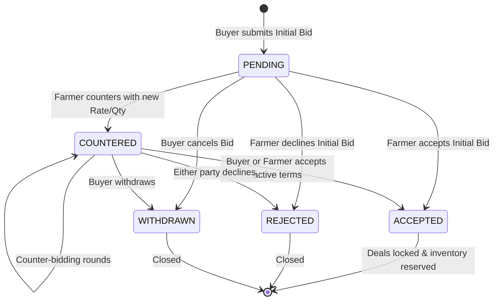

# AgriGuide Market — Matching Engine, Offers & Negotiation Architecture (Phase 2)

This document specifies the deterministic matching algorithm, negotiation state machine, atomic overselling protection, and the integration contract between the **AgriGuide Institutional Buyer Platform** and the shared Supabase / backend ecosystem.

---

## 1. Deterministic Matching Engine

The matching engine connects buyer procurement demands (`buying_requirements`) with explicitly published farmer stock (`selling_lots`). It is strictly deterministic, transparent, and auditable — no black-box LLMs or stochastic models determine market matches.

### A. Hard Exclusion Filters (Pass / Fail)
A selling lot is filtered out immediately if any of the following fail:
1. **Crop Commodity Match**: Normalized string match between `buying_requirements.crop_name` and `selling_lots.crop_name`.
2. **Available Quantity**: `selling_lots.available_quantity > 0` and `status IN ('ACTIVE', 'active')`.
3. **Variety Compatibility**: When the buyer requirement explicitly specifies a target variety (e.g. `Long Staple` or `Bt Hybrid`), the lot's `variety` or `quality_details` must contain compatible terms.
4. **Availability Deadline**: The lot's `expected_availability_date` must not exceed `buying_requirements.required_by_date` (with a max 3-day buffer).
5. **Quality Tier Compatibility**: Basic inspection standards must satisfy the requirement criteria.

---

### B. Deterministic Ranking Weights (0 – 100 Score)

For all lots that pass the hard filters, a deterministic composite score is computed using the following starting weights:

| Dimension | Weight | Evaluation Logic |
| :--- | :---: | :--- |
| **Price Compatibility** | **30%** | 100% if `asking_price <= max_price_per_unit` or `is_open_to_offers = true`. Progressively penalizes over-budget listings up to a 15% threshold. |
| **Quantity Fit & Fulfillment** | **25%** | 100% if `available_quantity >= remaining_needed`. Pro-rated `(available / remaining) * 100%` for partial fulfillment batches. |
| **Harvest Timeline** | **20%** | 100% if ready >= 3 days before deadline; 85% if ready on deadline date; scaled down for close tolerances. |
| **Logistics & Geography** | **15%** | 100% if same district; 80% if same state; 50% for interstate transit. |
| **Quality Grade** | **10%** | 100% for certified Grade A; 80% for Grade B; 70% for standard FAQ market quality. |

```
Total Match Score = (Price_Score * 0.30) + (Quantity_Score * 0.25) + (Availability_Score * 0.20) + (Location_Score * 0.15) + (Quality_Score * 0.10)
```

### C. Match Explanation Engine
Every match returns human-readable justification badges:
- `✓ Asking rate (₹X/quintal) is within your ceiling budget (₹Y)`
- `✓ Single-lot full fulfillment (X quintals available for Y needed)`
- `✓ Partial fulfillment batch (X quintals of Y needed)`
- `✓ Ready for pickup N days before deadline`
- `✓ Local district supply (Warangal) minimizes freight costs`
- `✓ Premium Grade A quality certification`

---

## 2. Partial Fulfillment Architecture

Institutional buyers frequently procure in volumes larger than any single smallholder farmer can produce:
- A requirement with `required_quantity = 50 quintals` can be fulfilled across multiple independent farmer lots (e.g., Farmer A: 20q, Farmer B: 30q).
- Each accepted offer atomically deducts from `selling_lots.available_quantity` and adds to `buying_requirements.fulfilled_quantity`.
- Remaining required quantity is calculated dynamically:
  $$\text{Remaining Needed} = \max(0, \text{required\_quantity} - \text{fulfilled\_quantity})$$
- When $\text{fulfilled\_quantity} \ge \text{required\_quantity}$, the requirement status transitions to `FULFILLED`.

---

## 3. Offer & Negotiation Lifecycle State Machine

Negotiation follows an append-only audit trail stored in `offers.message` as serialized JSON event arrays while indexed via top-level columns:



### Append-Only Event Structure:
```json
{
  "event_id": "evt_1728519450000",
  "actor": "BUYER",
  "action": "COUNTER",
  "quantity": 25.5,
  "price_per_unit": 7300,
  "unit": "quintal",
  "transport_responsibility": "buyer",
  "payment_terms": "50% advance on weighment, 50% on receipt",
  "message": "Adjusted price factoring warehouse transit costs",
  "timestamp": "2026-10-10T01:08:46.000Z"
}
```

---

## 4. Server-Side Atomic Overselling Protection

To prevent concurrent overselling (e.g. Farmer has 20 quintals, Buyer A and Buyer B both submit offers for 15 quintals):

1. **Pre-Acceptance Verification**:
   - Re-reads live `selling_lots` row from Supabase.
   - Evaluates `available_quantity >= agreed_quantity`.
2. **Atomic Inventory Mutation**:
   - Decrements `selling_lots.available_quantity = available_quantity - agreed_quantity`.
   - If `available_quantity` reaches `0`, updates `selling_lots.status = 'RESERVED'`.
3. **Requirement Demand Fulfillment Sync**:
   - If tied to `buying_requirement_id`, increments `fulfilled_quantity` and updates status to `FULFILLED` if quota is met.
4. **Transaction Abort on Insufficient Volume**:
   - If `available_quantity < agreed_quantity`, the operation throws an immediate `400 / 500 OVERSELLING REJECTED` error and makes no state changes.

---

## 5. Security & Ownership Architecture

- **Token Identity Derivation**: `req.user.id` is extracted strictly from the verified Supabase JWT. Client-supplied `buyer_id` or `farmer_id` parameters in request bodies are discarded.
- **Access Control Matrix**:
  - `GET /api/marketplace/requirements/:id/matches`: Only accessible by the owner of the requirement.
  - `GET /api/marketplace/offers`: Only returns offers where `buyer_id = req.user.id`.
  - `POST /api/marketplace/offers/:id/counter`: Verified against deal ownership.
  - `POST /api/marketplace/offers/:id/accept`: Verified against deal participant identity.
- **Privacy Masking**: Exact GPS farm boundaries and farmer private phone numbers remain masked until mutual deal acceptance.

---

## 6. Future Farmer Integration Contract

The farmer application (`src/` in the main AgriGuide app) does not need UI changes in Phase 2, but has the following ready-to-consume backend API contracts:

| Route | Method | Payload | Purpose |
| :--- | :--- | :--- | :--- |
| `/api/marketplace/farmer/offers` | `GET` | — | List all incoming bids on farmer's published lots |
| `/api/marketplace/offers/:id/counter` | `POST` | `{ actor: "FARMER", counter_price_per_unit, counter_quantity, counter_notes }` | Farmer proposes counteroffer |
| `/api/marketplace/offers/:id/accept` | `POST` | `{ actor: "FARMER" }` | Farmer accepts deal (triggers atomic inventory deduction) |
| `/api/marketplace/offers/:id/reject` | `POST` | `{ actor: "FARMER", reason }` | Farmer declines deal |

---

## 7. Explainable Price Compatibility (Phase 3 Core Differentiator)

### A. Principle and Role
AgriGuide Market helps institutional buyers understand whether a farmer's asking price is reasonable and whether that supply fits procurement budgets and regional mandi benchmark prices.

> **Disclaimer**: *The system provides decision support, not a guaranteed or authoritative market price.*

---

### B. Input Variables
The explainable matching engine deterministically evaluates the following inputs:
1. **Farmer Asking Price** (`selling_lots.asking_price_per_unit`): The unit rate published by the producer.
2. **Buyer Target Price** (`buying_requirements.target_price_per_unit`): Preferred procurement rate.
3. **Buyer Maximum Price** (`buying_requirements.max_price_per_unit`): Strict ceiling budget.
4. **Market Reference Price** (`market_prices.modal_price` / `price`): Verified regional APMC benchmark rate, market name, and observation date.
5. **Quantity & Remaining Needed** (`selling_lots.available_quantity` vs `buying_requirements.remaining_needed`).
6. **Availability Date** (`selling_lots.expected_availability_date` vs `buying_requirements.required_by_date`).
7. **Location & Distance** (`selling_lots.district / state` vs `buying_requirements.delivery_location`).
8. **Quality Grade** (`selling_lots.quality_grade` vs `buying_requirements.quality_grade`).

---

### C. Output Metrics & Scores

1. **Price Compatibility Score (0–100)**:
   - **90–100 (EXCELLENT)**: Farmer rate $\le$ buyer target price or $\le$ mandi reference.
   - **75–89 (GOOD)**: Farmer rate within buyer ceiling budget and $\le 5\%$ above mandi benchmark.
   - **60–74 (NEGOTIABLE)**: Farmer rate is within ceiling budget but exceeds target or mandi reference by $5\% - 15\%$.
   - **< 60 (POOR)**: Farmer rate exceeds buyer maximum ceiling budget.

2. **Deltas & Comparisons**:
   - **Farmer vs Market**: Percentage delta $\left(\frac{\text{Farmer Price} - \text{Market Reference}}{\text{Market Reference}} \times 100\right)\%$.
   - **Farmer vs Buyer Maximum Ceiling**: Percentage delta relative to ceiling budget.
   - **Farmer vs Buyer Target**: Percentage delta relative to preferred target.

3. **Reference Negotiation Range**:
   - Suggested spread formatted as `₹[Lower Bound] — ₹[Upper Bound] / Unit` based on $\min(\text{Market}, \text{Target})$ to $\text{Buyer Max Ceiling}$. Labeled strictly as *"Reference negotiation range"*.

4. **Overall Match Score (0–100)**:
   - Composite weighted score combining:
     - **Price Compatibility**: 30% *(Hero Metric)*
     - **Quantity Fit**: 25%
     - **Harvest Timeline / Availability**: 20%
     - **Logistics & Geography**: 15%
     - **Quality Tier**: 10%

5. **Human-Readable Explanation Badges**:
   - Plain-English assessment banner explaining whether the rate is above/below mandi reference and within buyer ceiling.
   - 3–5 concise, deterministic bullet points explaining the match reasoning at a glance.

